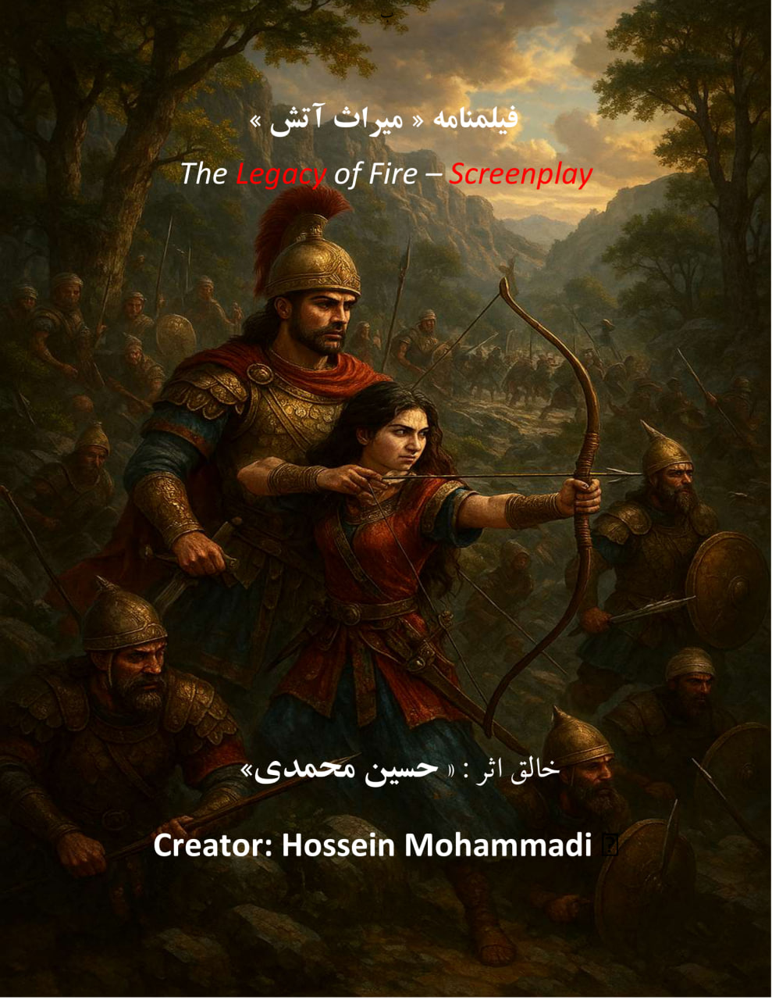

## درباره این اثر

«میراث آتش» حلقه نخست از سه‌گانه سینمایی «جنگ فراموش‌شده تاریخ» است؛ روایت مقاومت مردمانی که در سایه هجوم سپاه اسکندر، در برابر نابودی سرزمین و هویت خویش ایستادند.

<a class="btn" href="/screenplays/miras-atash-synopsis/">مطالعه سیناپس</a>
